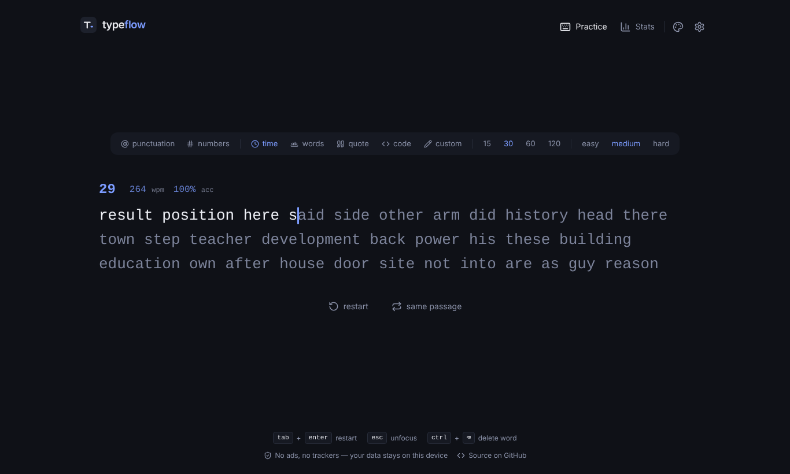
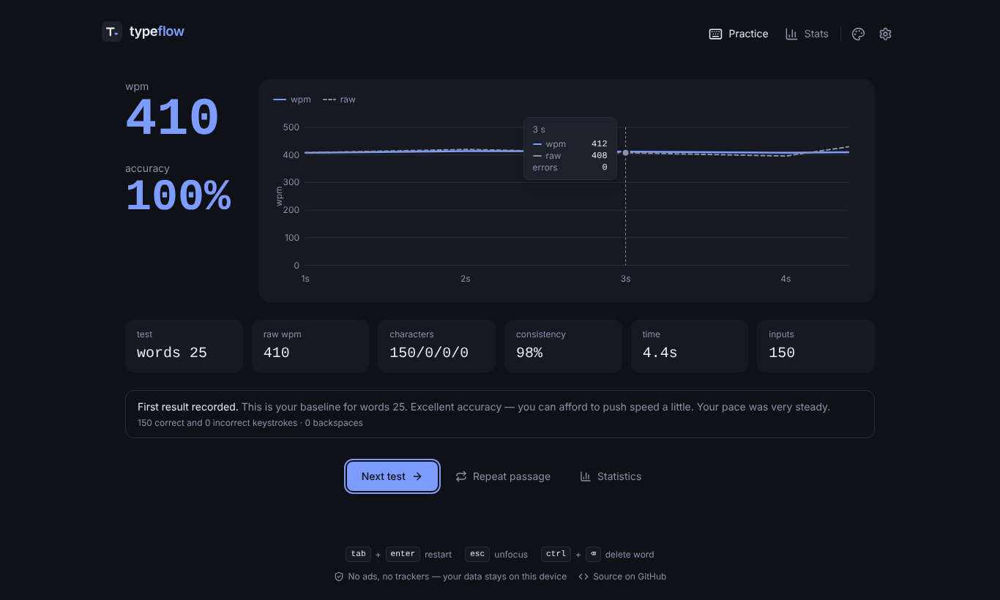
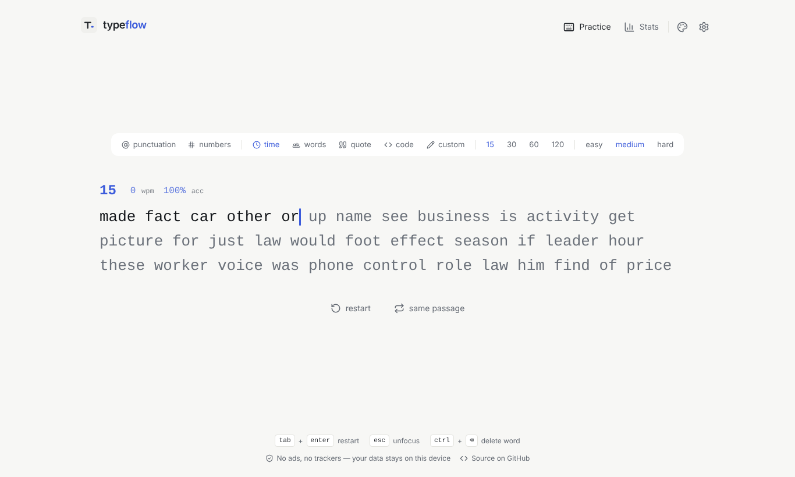
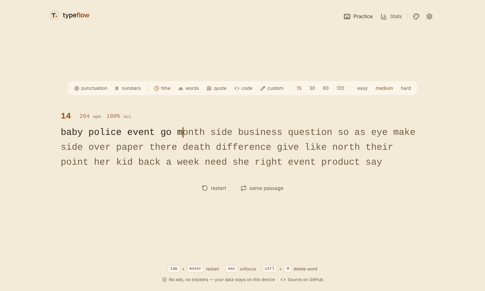
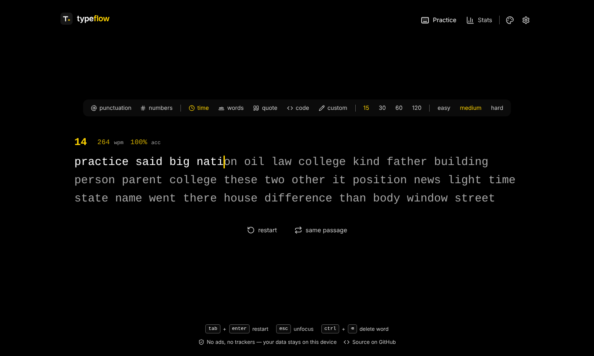
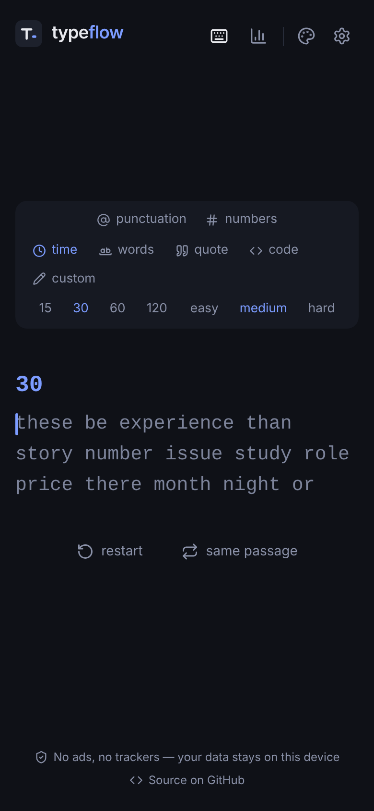

# TypeFlow

[**Try TypeFlow live →**](https://typeflow-mytype.vercel.app)

A fast, private, distraction-free typing practice app. No ads, no trackers, no sign-up. Everything runs in your browser and your data stays on your device.



## Key features

- **Five test modes**
  - **Time**: 15, 30, 60 or 120 seconds. The clock starts on your first keystroke and the test ends exactly on time.
  - **Words**: 10, 25, 50 or 100 words.
  - **Quote**: short, medium and long passages (original or public-domain text).
  - **Code**: short Python, JavaScript and TypeScript snippets. Press Enter for a new line and the indentation fills in for you.
  - **Custom**: paste your own essay, interview answers or technical terms (up to 5,000 characters).
- **Word options**: punctuation, numbers, and easy / medium / hard word lists.
- **Accurate statistics**: WPM, raw WPM, accuracy, consistency, correct / incorrect / extra / missed characters, and a WPM-over-time chart. Every formula is documented and unit tested.
- **Progress tracking**: total tests, practice time, average and best WPM, average accuracy, a progress chart, a daily activity heatmap, and current and longest streaks.
- **Your data stays yours**: history lives in `localStorage` (capped at 500 tests). You can export it to JSON, import it with validation, clear it, or reset everything.
- **Six themes**: Midnight Dark (default), Minimal Light, Ocean Blue, Forest Green, Warm Sepia and High Contrast, all built with CSS variables.
- **Personalization**: font size, line height, caret style (line, block, underline), smooth caret, live stats on/off, optional keystroke sounds (off by default), and motion control (follow the system, reduce, or full).
- **Accessible**: semantic HTML, visible focus rings, keyboard-only use, screen-reader result summaries, chart data tables, reduced-motion support, and errors shown by underlines as well as color.
- **Works offline** after the first visit, using a tiny service worker generated at build time.

| Results | Statistics |
| --- | --- |
|  |  |

| Minimal Light | Warm Sepia | High Contrast | Mobile |
| --- | --- | --- | --- |
|  |  |  |  |

## Tech stack

React 19, TypeScript (strict), Vite, Tailwind CSS v4, and Lucide icons. Tests use Vitest, React Testing Library and jsdom. The end-to-end smoke test uses Playwright.

There is no backend, database, auth, analytics, web font or charting library. Charts are hand-written SVG.

## Getting started

Requires **Node.js 22.13 or newer**.

```bash
npm install
npm run dev        # http://localhost:5173
```

### Scripts

| Command | What it does |
| --- | --- |
| `npm run dev` | Start the dev server |
| `npm run build` | Type-check and build the static site into `dist/` |
| `npm run preview` | Serve the production build locally |
| `npm test` | Run the unit and component tests once |
| `npm run test:watch` | Run the tests in watch mode |
| `npm run lint` | Run ESLint |
| `npm run typecheck` | Run TypeScript without building |
| `npm run e2e` | Build first, then run the Playwright smoke test and performance measurements |

For `npm run e2e` you need a Chromium browser that Playwright can use. Either run `npx playwright install chromium` once, or set `CHROMIUM_PATH=/path/to/chrome`.

## Deployment

The build output in `dist/` is a plain static site. It uses relative asset paths (`base: './'`), so the same build works at a domain root and inside a sub-folder.

### Vercel
1. Push the repository to GitHub.
2. In Vercel, choose **Add New → Project** and import the repo.
3. Vercel reads `vercel.json` (framework Vite, build `npm run build`, output `dist`). Click **Deploy**.

### Netlify
1. Push the repository to GitHub.
2. In Netlify, choose **Add new site → Import an existing project**.
3. `netlify.toml` already sets the build command, the `dist` publish folder, Node 22, and cache headers. Click **Deploy**.

You can also drag the `dist/` folder onto Netlify Drop.

### GitHub Pages
1. Make sure the workflow is at `.github/workflows/deploy.yml`. A copy also lives at `deploy/github-pages.yml`; if `.github/workflows/` is empty, move it there with `mkdir -p .github/workflows && mv deploy/github-pages.yml .github/workflows/deploy.yml`.
2. Push the repository to GitHub, using `main` as the default branch.
3. Go to **Settings → Pages** and set **Source** to **GitHub Actions**.
4. Every push to `main` runs the workflow: lint, then test, then build, then deploy. The site appears at `https://<user>.github.io/<repo>/`.

You don't need a repository-specific base path. If you ever want an absolute one, build with `BASE_PATH=/<repo>/ npm run build`.

No environment variables or secrets are needed anywhere.

## Architecture

```
src/
├── App.tsx                 # view switching, passage lifecycle, saving results
├── main.tsx                # entry + service-worker registration (production only)
├── components/             # shared UI: Header, Footer, Dialog, LineChart, ThemeMenu, Switch…
├── features/
│   ├── typing/             # TestView, TypingArea, Word, TestClock, ConfigBar, CustomTextDialog, controller
│   ├── results/            # ResultsView + plain-language summary
│   ├── statistics/         # StatsView (lazy-loaded) + ActivityHeatmap
│   └── settings/           # SettingsDialog (lazy-loaded)
├── hooks/                  # settings context, engine subscriptions, media queries, sound
├── lib/                    # framework-free, unit-tested logic
│   ├── engine.ts           # the typing engine
│   ├── stats.ts            # WPM / accuracy / consistency formulas
│   ├── passage.ts          # builds the text for each mode
│   ├── textGenerator.ts    # seeded word / punctuation / number generator
│   ├── history.ts          # history store, validation, import/export, limits
│   ├── aggregate.ts        # summary stats, streaks, activity grid
│   ├── settings.ts         # defaults + sanitizing persisted settings
│   └── customText.ts, storage.ts, sound.ts, random.ts, result.ts, format.ts
├── data/                   # word lists, quotes, code snippets
├── styles/                 # Tailwind entry + theme variables
├── types/                  # shared TypeScript types
└── tests/                  # Vitest unit + component tests
scripts/
├── sw-plugin.ts            # Vite plugin that generates the service worker
└── e2e-smoke.mjs           # Playwright smoke test + performance report
```

**How a keystroke flows.** A hidden, focused `<textarea>` receives input. Its `keydown` handler, plus `input` / `beforeinput` / composition fallbacks for mobile keyboards and IMEs, passes characters to the `InputController`. The controller passes them to the `TypingEngine`, a plain TypeScript class that keeps its state in typed arrays. The engine notifies subscribers, and React reads it with `useSyncExternalStore`. Each `Word` is memoized on a per-word version number, so a keystroke re-renders only the one or two words it touched. The caret and line scrolling are updated with a single layout read and CSS `transform` writes.

## How the statistics are calculated

A "word" is always **5 characters**, spaces included. Time is measured from the **first keystroke** to the last keystroke, or to the exact end of the timer in time mode.

| Metric | Formula |
| --- | --- |
| **Raw WPM** | (all character inputs ÷ 5) ÷ minutes |
| **WPM** | (correct characters in the final text ÷ 5) ÷ minutes |
| **Accuracy** | correct inputs ÷ (correct + incorrect inputs) × 100 |
| **Consistency** | 100 × (1 − standard deviation ÷ mean) of the per-second raw WPM, clamped to 0–100 |

**Live text vs. keystroke history.** There are two sets of counters:

- *Inputs* record every character you ever typed. If you fix a typo, the original mistake still counts against **accuracy**.
- *Characters* describe the final text. Fixing a typo turns it back into a correct character, so **WPM** goes up.

Edge cases:

- **Backspace** is not a character input. It undoes the text state and nothing else.
- **Extra characters** are letters typed past the end of a word. They count as incorrect inputs and are shown struck through.
- **Missed characters** are skipped by pressing space early (prose modes). They are underlined in the passage and don't count as correct.
- **Auto-filled indentation** in code mode is excluded from every count. Typing those spaces out of habit is ignored.
- **Zero elapsed time or no input** gives 0 for WPM, raw WPM and accuracy instead of `NaN` or `Infinity`.
- **Tests shorter than 1 second** still show results but are not saved to history.
- **Focus changes**: the clock keeps running if you leave the page mid-test, so pausing can't inflate a result. Click the text or press any letter to continue.

## Performance

TypeFlow is built to stay light. These numbers come from the Playwright run (`npm run e2e`) in headless Chromium 141; see [docs/PERFORMANCE.md](docs/PERFORMANCE.md):

| Measurement | Result |
| --- | --- |
| Keystroke processing (engine + React commit) | median **0.6 ms**, p95 1.7 ms |
| Keydown → next frame | median ~8 ms, p95 ~16 ms (one frame at 60 Hz) |
| JS heap after load | ~2.0 MB used |
| JS heap after several tests and the stats page | ~4.5 MB used |
| 30 restart cycles | no event-listener growth; heap +0.2 MB |
| Transfer size on first load | ~99 KB (gzip); 0 requests to other origins |

Design choices that keep it fast:

- Typing state lives outside React, and only touched words re-render.
- Only one timeout runs at a time, and only while a test is running. Live numbers update once per second.
- Nothing is written to storage per keystroke. A result is saved once, when the test finishes, and history is capped at 500 tests.
- The statistics page, settings dialog and custom-text dialog are code-split.
- There are no web fonts, images, analytics or third-party requests.
- The caret and lines move with `transform` only. Animations respect reduced motion.

## Privacy

Nothing leaves your device. There are no cookies, no analytics, no ads and no external fonts or scripts. Settings and history are stored in your browser's `localStorage` under keys that start with `typeflow:`.

## Known limitations

- **Mobile keyboards.** Some Android keyboards send whole words through composition events. The text updates when each word is committed, not after every letter. Accuracy is still tracked correctly.
- **Memory numbers.** These were measured in headless Chromium on a Linux container. Real devices and browsers will vary.
- **Offline support** starts working after the first full online visit, once the service worker is installed.

## Future ideas

- Per-key heatmap of your most common mistakes
- More languages for word lists and code snippets
- A practice mode built from your weakest words
- An optional zen mode with no target text

## License

[MIT](LICENSE)
